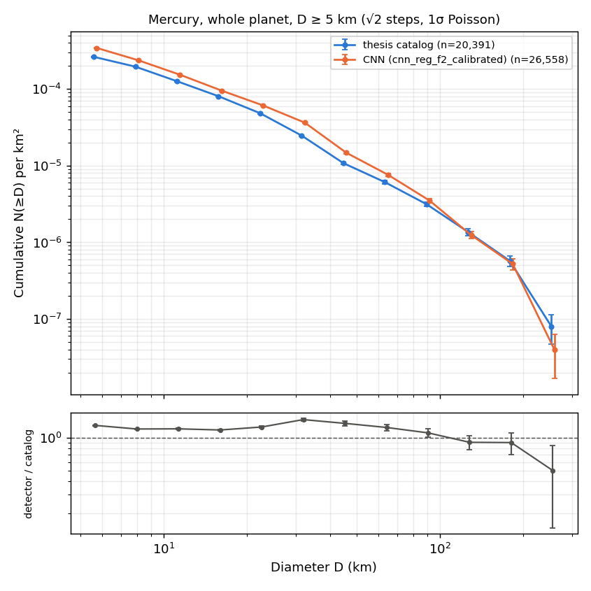

# Global run: `cnn_reg_f2` over the whole planet vs the thesis catalog

The thesis catalog (Horstman 2016) took about a year of hand mapping in JMARS. This run detects
craters ≥ 5 km over all of Mercury in **about 7 minutes** on one RTX 3060 Ti, then compares the
result with that catalog.

```
conda run -n mercury-craters python -m craters.phase3 global     # tiles + detection, ~7 min
conda run -n mercury-craters python -m craters.compare_global    # counts, SFDs, maps, matching, ~1 min
conda run -n mercury-craters python -m craters.calibrate         # catalog-like version of the run (below)
conda run -n mercury-craters python -m craters.compare_global --calibrated   # -> outputs/global/calibrated/
```

## Calibrated run: closer to the thesis catalog (2026-11-04)

The raw run below is tuned for recall: one score cutoff (0.15, chosen on V1 F2) for every size. The
thesis counted only craters with clearly defined rims. `python -m craters.calibrate` adjusts the run
towards that definition, fitting both steps without looking at T1–T3:

1. **Diameter correction per level**, from matched pairs in the train and V1 areas:
   - The fine level draws craters up to 9% small; the largest correction is at ~12 km.
   - The coarse level draws ≥ 70 km craters 6–7% small.
   - Detections are scaled by the median ratio, interpolated in log D.
2. **Score cutoff by size**, the best V1 F1 within each diameter band:
   - 0.20 for 5–10 km and 0.15 above.
   - Bands with fewer than 50 V1 craters (≥ 40 km) keep the run's own cutoff.

Thresholds are in `config/default.yaml` under `calibration`. The fitted values are in
`outputs/global/calibration.json`.

| | Raw | Calibrated |
|---|---:|---:|
| Detections ≥ 5 km | 38,462 | 26,558 |
| T1–T3 P / R / F1 | 0.51 / 0.79 / 0.618 | 0.67 / 0.68 / **0.674** |
| T1–T3 F1 at 5–10 / 10–20 / 20–50 / ≥ 50 km | 0.51 / 0.83 / 0.80 / 0.77 | 0.57 / 0.80 / 0.80 / 0.77 |
| Whole-planet catalog recall ≥ 50 km | 0.91 | 0.92 |

Whole-planet cumulative ratio, CNN / catalog, N(≥D):

| D (km) | 5.7 | 8 | 11.3 | 16 | 22.6 | 32 | 45 | 64 | 91 | 128 | 181 |
|---|---|---|---|---|---|---|---|---|---|---|---|
| raw | 1.67 | 1.21 | 1.06 | 1.11 | 1.23 | 1.64 | 1.38 | 1.20 | 0.92 | 0.79 | 0.60 |
| calibrated | 1.31 | 1.21 | 1.21 | 1.19 | 1.26 | 1.48 | 1.36 | 1.25 | 1.11 | 0.91 | 0.91 |



- **The large-crater deficit is mostly gone** (0.60 → 0.91 at 181 km). Much of it was the CNN drawing
  big craters ~7% small, so they fell under the size bins.
- **The calibrated curve sits 1.2–1.5× above the catalog at every size.** Part of that excess lies in
  the areas where Phase 0 found the catalog thin.
- **The 30–45 km bump (1.48) is partly a level effect.** The fine level rarely detects craters over
  25 km, so 22–30 km craters are found by the coarse level, drawn up to ~30% large and counted in
  the 30–35 km bin. The V1 cutoff search kept 0.15 for 20–40 km, so calibration leaves it in.
- **The poles are the weakest area, and retraining didn't fix them.** Calibrated F1 is 0.38 at
  |lat| ≥ 60°, and 0.21 in the two held-out polar boxes P1 and P2 (`regions.polar`, 133 catalog
  craters). Three things are mixed together there:
  - **The catalog is thin.** It lists fewer 5–10 km craters than 10–20 km ones at the poles; every
    other area has the reverse.
  - **Positions don't line up.** Centre offsets are scattered and as large as half a diameter.
    Polar recall at 5–10 km is 0.28 under the 0.5·D rule and 0.54 under 1·D.
  - **The detector misses craters.** Even at 1·D, polar recall at 10–50 km is only 0.56–0.64.

  Three fixes were tried, and none helped (`docs/phase3-notes.md` §3.3f):
  - extending the north-south registration to the poles;
  - two retrains that included polar tiles;
  - one of those retrains with polar labels under 10 km ignored.

  P1–P2 F1 stayed at 0.15–0.17.

What was tried for the large craters and didn't work is in `docs/phase3-notes.md` §3.3e: a lower
cutoff, a very coarse level, and a coarse-only fine-tune.

| Step | Time | Notes |
|---|---|---|
| Render and cache tiles | 263 s | 5,580 tiles, 6 workers. 3.2 GB was already cached from Phase 3, and the run added about 2.4 GB, for ~5.6 GB in total. That is under the 20 GB limit, so tiles are cached, not rendered on the fly. |
| CNN inference + overlap merge | 164 s | 38,462 detections after merging (54,598 before the twin fix) |

**Twin fix (2026-11-03).** The first run gave 54,598 detections, and 61% of them sat in
side-by-side same-size pairs, mostly east-west, against 3.9% in the catalog. The CNN often marked
one crater twice: a second, weaker circle ~0.8 D west of the real one. Decoding now drops a weaker
circle within 1 D of a stronger one of similar size, and the tile merge uses the same rule
(phase3-notes.md §3.3c). Same weights and cutoff. The rerun has 38,462 detections, 0.5% of them in
such pairs; the old file is kept in `data/detections_pre_twinfix/`. Every number below is from the
rerun, with the old value in brackets where it matters.
- The fly-over video (`python -m craters.video`) was rendered before the fix. Its captions quote
  no affected numbers, but its orange circles include the twins, so it needs re-rendering.
- The rerun's 0.5% pair rate is below the catalog's 3.9%. Of two genuinely overlapping same-size
  craters, the weaker is now dropped.

**Outputs:**
- `data/detections/global_cnn_reg_f2.parquet` (lon, lat, diameter_km, score, level, n_tiles, tile_id);
- `data/processed/tiles_global.parquet`;
- tables and figures in `outputs/global/`: `counts_by_bin.csv`, `sfd_ratio.csv`, `match_by_area.csv`,
  `density_cells.csv`, `run_timing.json` and `consistency.json`.

## How the planet is tiled

Phase 1 tiles cover |lat| ≤ 60° (the train/test design). The global run keeps those tiles
unchanged, with the same ids and cache, and adds **polar-cap rows** (`tiling.make_cap_tiles`).
- Each cap runs from the edge of the outermost Phase 1 cell to its pole. Its rows are spread
  evenly, so no row centre falls past ±90°, and the spacing is never wider than the level's step.
- The same two levels are used: fine 166 m/px for 5–40 km and coarse 665 m/px for 30–400 km. Each
  tile is still reprojected to a stereographic grid centred on the tile, so polar craters stay
  round.
- The caps add 755 fine and 103 coarse tiles.

Coverage check (random points over the sphere, densest near the poles and the 60° seams):
- Every point lies inside some tile with an inset of at least 127 px (fine) or 253 px (coarse).
  The design target is 128 / 256 px, so the guarantee holds to within 3 px.
- On average a point lies in 2.2 fine tiles. At the poles, at most 7 fine tiles meet. That is
  modest duplication, and the overlap merge removes it.

As a check, the global run puts **3,092** detections in T1–T3, the same as the Phase 3 test run.
Raw F1 there is 0.617 (0.618 in the Phase 3 scoring, which matches T1–T3 on its own).

## Headline numbers (D ≥ 5 km)


| Diameter bin | Thesis catalog | CNN | CNN / catalog |
|---|---:|---:|---:|
| 5–10 km | 9,304 | 26,226 | **2.82** (was 4.4) |
| 10–20 km | 6,710 | 7,045 | **1.05** (was 1.22) |
| 20–50 km | 3,685 | 4,260 | 1.16 (was 1.22) |
| ≥ 50 km | 692 | 931 | 1.35 (was 1.37) |
| **All ≥ 5 km** | **20,391** | **38,462** | **1.89** (was 2.7) |

Per latitude band (all ≥ 5 km, catalog → CNN):
- 60–90°N: 866 → 1,842
- 30–60°N: 3,546 → 6,939
- 0–30°N: 6,138 → 11,702
- 0–30°S: 5,891 → 10,568
- 30–60°S: 3,282 → 5,950
- 60–90°S: 668 → 1,461

The full table is in `outputs/global/counts_by_bin.csv`.

## Size-frequency distributions

Both curves are cumulative, with √2 diameter steps and 1σ Poisson errors (`sfd.py`).


Whole-planet cumulative ratio, CNN / catalog, N(≥D):

| D (km) | 5.7 | 8 | 11.3 | 16 | 22.6 | 32 | 45 | 64 | 91 | 128 | 181 |
|---|---|---|---|---|---|---|---|---|---|---|---|
| ratio | 1.67 | 1.21 | 1.06 | 1.11 | 1.23 | 1.64 | 1.38 | 1.20 | 0.92 | 0.79 | 0.60 |

**Where the curves agree and where they diverge:**
- **11–23 km: they agree** within 6–23%. The two counts are independent, so this is the
  cleanest test that the detector reproduces the catalog's population.
- **Below ~10 km the CNN climbs steeply:** 1.7× at N(≥5.7 km) (2.5× before the twin fix). The catalog's cumulative curve
  flattens there and the CNN's does not. Which reading is right is open; see Caveat 1.
- **Bump near 30–45 km (ratio 1.4–1.6):** this is where the fine level (≤ 40 km) and coarse level
  (≥ 30 km) overlap. Some craters probably survive as two detections whose diameters differ by more
  than the 1.33 merge ratio. Terraced rims and nested rings are other likely causes. This bump is
  probably a detector artefact, not a real excess.
- **Above ~90 km the CNN falls below the catalog** (0.6–0.9×). Degraded basins are hard to see,
  and anything wider than the coarse overlap (341 km) can't lie wholly inside one tile.

The shape is the same in every latitude band:


## Where they disagree on the map


The ratio map is orange almost everywhere, because the CNN finds more 5–10 km craters. It is
deepest in two places:
- **the 180–240°E stripe and 0–60°E,** where Phase 0 already found the catalog thin and these
  areas were left out of training (dotted boxes);
- **the ±60° caps,** where the catalog density drops off.

The CNN map has hot spots at 270–330°E, 0–60°N (around T1/T2) and at 120–180°E near the equator.
These may reflect imaging conditions in the mosaic as well as real crater density. They haven't
been checked.

## Match statistics (raw, against the catalog)

Matching is one Hungarian match over the whole planet (`match.py`). TP/FN are then counted by the
catalog crater's area and FP by the detection's. "Raw" means every unmatched detection counts as
a false positive, including the real uncatalogued craters that the T1–T3 review found.

| Area | Catalog | CNN | P | R | F1 | R 5–10 | R 10–20 | R 20–50 | R ≥50 |
|---|---:|---:|---:|---:|---:|---:|---:|---:|---:|
| **T1–T3 (held out)** | 1,982 | 3,090 | 0.51 | **0.79** | 0.62 | 0.75 | 0.83 | 0.86 | 0.82 |
| V1 (checkpoint selection) ⚠ | 487 | 847 | 0.49 | 0.85 | 0.62 | 0.84 | 0.89 | 0.82 | 0.88 |
| train (labels seen) ⚠ | 11,792 | 21,073 | 0.44 | 0.79 | 0.57 | 0.75 | 0.80 | 0.86 | 0.97 |
| other, \|lat\| < 60° (not trained) | 4,596 | 10,146 | 0.33 | 0.72 | 0.45 | 0.64 | 0.73 | 0.81 | 0.90 |
| polar, \|lat\| ≥ 60° (not trained) | 1,534 | 3,306 | 0.22 | 0.48 | 0.30 | 0.29 | 0.43 | 0.58 | 0.83 |
| whole planet | 20,391 | 38,462 | 0.40 | 0.75 | 0.52 | 0.71 | 0.76 | 0.81 | 0.91 |

Before the twin fix, the whole planet was P 0.30 / R 0.80 / F1 0.43, and T1–T3 0.35 / 0.82 / 0.49.

⚠ **Optimistic rows.** The model was trained on the train labels and its checkpoint was chosen on
V1, so treat only T1–T3 as a fair estimate.

After the user's T1–T3 review, verdict-adjusted F1 on T1–T3 is 0.80 (0.77 at 5–10 km, 0.89 at
10–20 km). 56% of the reviewed unmatched 5–10 km detections were judged real; it was 65% before the
twin fix, because many twins had been marked real. See `docs/phase4-notes.md`.
No review exists outside T1–T3.

The "other" and "polar" rows fall well below T1–T3. They mix three effects that this run can't
separate:
1. a weaker detector off its training distribution (high-incidence polar lighting, and different
   mosaic quality);
2. a catalog that may be less complete there (Phase 0);
3. a missing registration. Only 1,566 of the 6,218 "excluded" catalog craters, and few polar ones,
   received the north-south correction. A 5–10 km crater sitting several kilometres off its
   basemap position fails the 0.5·D centre rule.

## Caveats

1. **What the 5–10 km excess means is not settled.** The CNN finds 2.8× as many 5–10 km craters as
   the catalog, and in T1–T3 a little over half of the reviewed extras were real craters. There
   are two readings, and this run can't choose between them:
   - **The catalog is incomplete below ~10 km.** On this reading, the CNN is filling in a real
     population that a year of hand mapping at ~250 m/px didn't reach.
   - **The thesis used a stricter definition or completeness limit.** For example, it may have
     left out degraded, overlapping or secondary craters, or set a practical completeness cut near
     10 km. Then the CNN's extra small craters are real features the catalog never set out to
     include. On this reading, below ~10 km the two SFDs measure different things, and the
     agreement at 11–23 km is the like-for-like comparison.

   **The author's recollection (2026-11-03) supports the second reading:** the thesis was strict,
   counting only craters with clearly defined rims, which are hard to see for small degraded
   craters. The T1–T3 review asked a looser question ("is this a real crater of about this
   size?"), so its "real" rate measures something broader than the thesis criterion.
2. **Precision outside T1–T3 is unreviewed.** In T1–T3 the review found that 56% of reviewed
   unmatched 5–10 km detections were real. That rate may not hold at the poles or in the excluded stripes,
   where lighting and mosaic quality differ.
3. **Detection counts are not calibrated crater densities.** No completeness or false-positive
   correction is applied. The 30–45 km bump and the >90 km deficit are known detector effects.
4. **Positions:** the catalog is used with registered positions where Phase 4 had enough matched
   pairs (`catalog_registered_labels`). Elsewhere the original positions are kept, which lowers
   match rates there.
5. **Train/V1 numbers are optimistic,** as flagged above.
