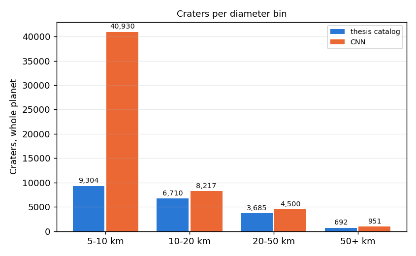
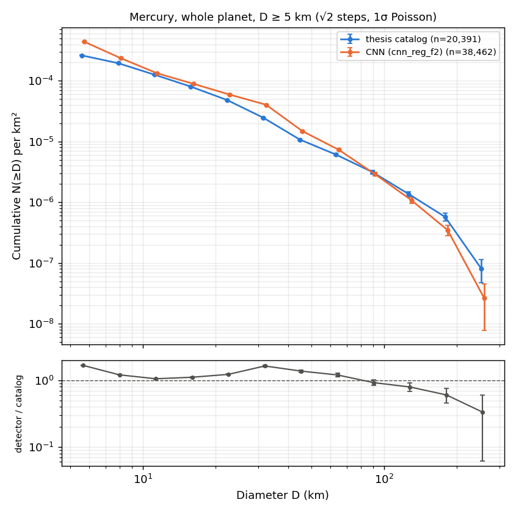
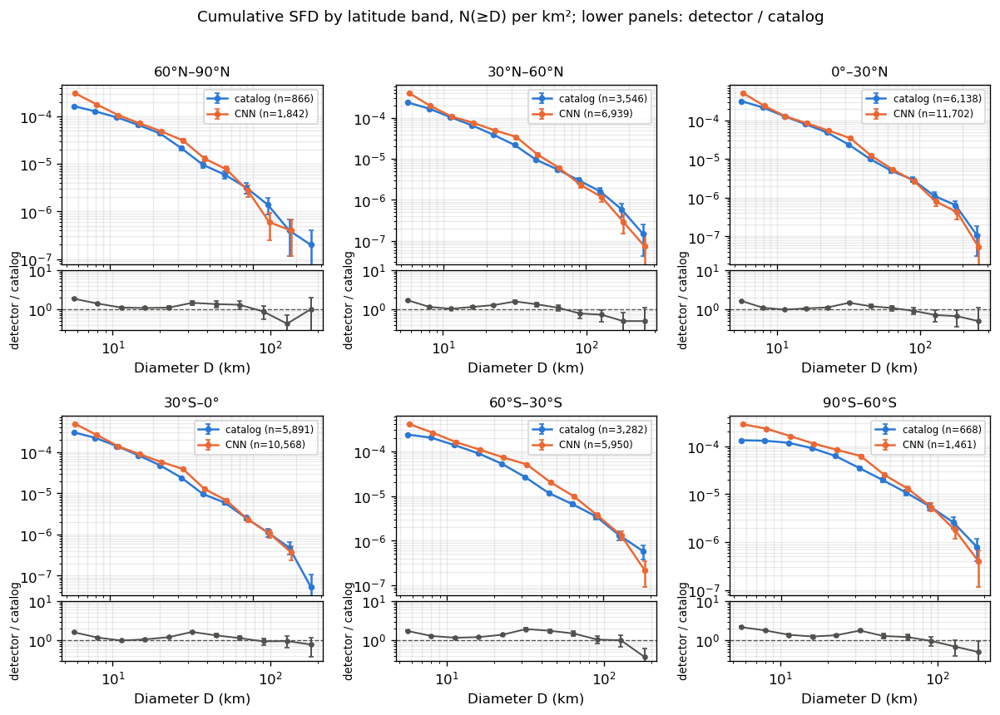
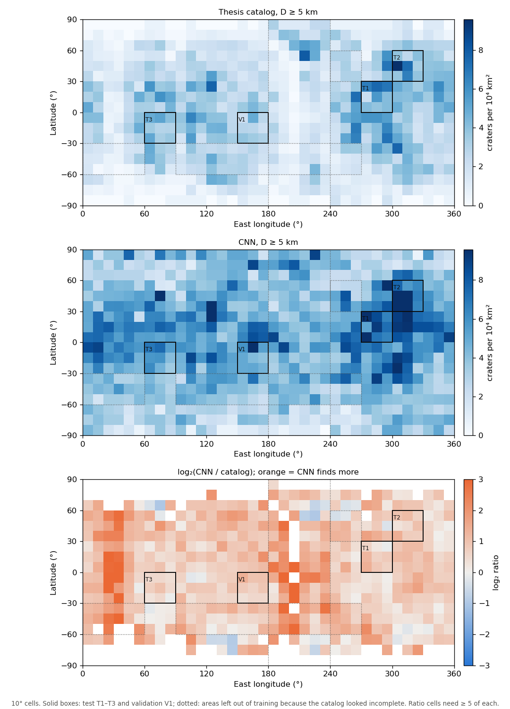

# Global run: `cnn_reg_f2` over the whole planet vs the thesis catalog

The thesis catalog (Horstman 2016) took about a year of hand mapping in JMARS. This run detects
craters ≥ 5 km over all of Mercury in **about 7 minutes** on one RTX 3060 Ti, then compares the
result with that catalog.

```
conda run -n mercury-craters python -m craters.phase3 global     # tiles + detection, ~7 min
conda run -n mercury-craters python -m craters.compare_global    # counts, SFDs, maps, matching, ~1 min
```

| Step | Time | Notes |
|---|---|---|
| Render and cache tiles | 263 s | 5,580 tiles, 6 workers. 3.2 GB was already cached from Phase 3, and the run added about 2.4 GB, for ~5.6 GB in total. That is under the 20 GB limit, so tiles are cached, not rendered on the fly. |
| CNN inference + overlap merge | 170 s | 54,598 detections after merging |

**Outputs:**
- `data/detections/global_cnn_reg_f2.parquet` (lon, lat, diameter_km, score, level, n_tiles, tile_id);
- `data/processed/tiles_global.parquet`;
- tables and figures in `outputs/global/`: `counts_by_bin.csv`, `sfd_ratio.csv`, `match_by_area.csv`,
  `density_cells.csv`, `run_timing.json` and `consistency.json`.

## How the planet is tiled

Phase 1 tiles cover |lat| ≤ 60° (the train/test design). The global run keeps those tiles
unchanged, with the same ids and cache, and adds **polar-cap rows** (`tiling.make_cap_tiles`).
- Each cap runs from the edge of the outermost Phase 1 cell to its pole. Its rows are spread
  evenly, so no row centre falls past ±90°, and the spacing is never wider than the level's step.
- The same two levels are used: fine 166 m/px for 5–40 km and coarse 665 m/px for 30–400 km. Each
  tile is still reprojected to a stereographic grid centred on the tile, so polar craters stay
  round.
- The caps add 755 fine and 103 coarse tiles.

Coverage check (random points over the sphere, densest near the poles and the 60° seams):
- Every point lies inside some tile with an inset of at least 127 px (fine) or 253 px (coarse).
  The design target is 128 / 256 px, so the guarantee holds to within 3 px.
- On average a point lies in 2.2 fine tiles. At the poles, at most 7 fine tiles meet. That is
  modest duplication, and the overlap merge removes it.

As a check, the global run puts **4,598** detections in T1–T3, against 4,599 from the Phase 3
test run. Raw F1 there, 0.494, is identical.

## Headline numbers (D ≥ 5 km)



| Diameter bin | Thesis catalog | CNN | CNN / catalog |
|---|---:|---:|---:|
| 5–10 km | 9,304 | 40,930 | 4.4 |
| 10–20 km | 6,710 | 8,217 | 1.22 |
| 20–50 km | 3,685 | 4,500 | 1.22 |
| ≥ 50 km | 692 | 951 | 1.37 |
| **All ≥ 5 km** | **20,391** | **54,598** | **2.7** |

Per latitude band (all ≥ 5 km, catalog → CNN):
- 60–90°N: 866 → 2,549
- 30–60°N: 3,546 → 9,624
- 0–30°N: 6,138 → 16,985
- 0–30°S: 5,891 → 15,240
- 30–60°S: 3,282 → 8,342
- 60–90°S: 668 → 1,858

The full table is in `outputs/global/counts_by_bin.csv`.

## Size-frequency distributions

Both curves are cumulative, with √2 diameter steps and 1σ Poisson errors (`sfd.py`).



Whole-planet cumulative ratio, CNN / catalog, N(≥D):

| D (km) | 5.7 | 8 | 11.3 | 16 | 22.6 | 32 | 45 | 64 | 91 | 128 | 181 |
|---|---|---|---|---|---|---|---|---|---|---|---|
| ratio | 2.45 | 1.64 | 1.12 | 1.16 | 1.30 | 1.72 | 1.41 | 1.23 | 0.93 | 0.80 | 0.63 |

**Where the curves agree and where they diverge:**
- **11–23 km: they agree** within 12–30%. The two counts are independent, so this is the
  cleanest test that the detector reproduces the catalog's population.
- **Below ~10 km the CNN climbs steeply:** 2.5× at N(≥5.7 km). The catalog's cumulative curve
  flattens there and the CNN's does not. Which reading is right is open; see Caveat 1.
- **Bump near 30–45 km (ratio 1.4–1.7):** this is where the fine level (≤ 40 km) and coarse level
  (≥ 30 km) overlap. Some craters probably survive as two detections whose diameters differ by more
  than the 1.33 merge ratio. Terraced rims and nested rings are other likely causes. This bump is
  probably a detector artefact, not a real excess.
- **Above ~90 km the CNN falls below the catalog** (0.6–0.9×). Degraded basins are hard to see,
  and anything wider than the coarse overlap (341 km) can't lie wholly inside one tile.

The shape is the same in every latitude band:



## Where they disagree on the map



The ratio map is orange almost everywhere, because the CNN finds more 5–10 km craters. It is
deepest in two places:
- **the 180–240°E stripe and 0–60°E,** where Phase 0 already found the catalog thin and these
  areas were left out of training (dotted boxes);
- **the ±60° caps,** where the catalog density drops off.

The CNN map has hot spots at 270–330°E, 0–60°N (around T1/T2) and at 120–180°E near the equator.
These may reflect imaging conditions in the mosaic as well as real crater density. They haven't
been checked.

## Match statistics (raw, against the catalog)

Matching is one Hungarian match over the whole planet (`match.py`). TP/FN are then counted by the
catalog crater's area and FP by the detection's. "Raw" means every unmatched detection counts as
a false positive, including the real uncatalogued craters that the T1–T3 review found.

| Area | Catalog | CNN | P | R | F1 | R 5–10 | R 10–20 | R 20–50 | R ≥50 |
|---|---:|---:|---:|---:|---:|---:|---:|---:|---:|
| **T1–T3 (held out)** | 1,982 | 4,596 | 0.35 | **0.82** | 0.49 | 0.79 | 0.85 | 0.88 | 0.85 |
| V1 (checkpoint selection) ⚠ | 487 | 1,198 | 0.36 | 0.89 | 0.52 | 0.88 | 0.93 | 0.89 | 0.88 |
| train (labels seen) ⚠ | 11,792 | 30,277 | 0.32 | 0.83 | 0.47 | 0.81 | 0.84 | 0.88 | 0.98 |
| other, \|lat\| < 60° (not trained) | 4,596 | 14,117 | 0.25 | 0.77 | 0.38 | 0.71 | 0.77 | 0.84 | 0.90 |
| polar, \|lat\| ≥ 60° (not trained) | 1,534 | 4,410 | 0.18 | 0.52 | 0.27 | 0.39 | 0.44 | 0.60 | 0.87 |
| whole planet | 20,391 | 54,598 | 0.30 | 0.80 | 0.43 | 0.77 | 0.79 | 0.83 | 0.93 |

⚠ **Optimistic rows.** The model was trained on the train labels and its checkpoint was chosen on
V1, so treat only T1–T3 as a fair estimate.

After the user's T1–T3 review, verdict-adjusted F1 on T1–T3 is 0.81 (0.80 at 5–10 km, 0.86 at
10–20 km), and 73% of reviewed 5–10 km detections were judged real. See `docs/phase4-notes.md`.
No review exists outside T1–T3.

The "other" and "polar" rows fall well below T1–T3. They mix three effects that this run can't
separate:
1. a weaker detector off its training distribution (high-incidence polar lighting, and different
   mosaic quality);
2. a catalog that may be less complete there (Phase 0);
3. a missing registration. Only 1,566 of the 6,218 "excluded" catalog craters, and few polar ones,
   received the north-south correction. A 5–10 km crater sitting several kilometres off its
   basemap position fails the 0.5·D centre rule.

## Caveats

1. **What the 5–10 km excess means is not settled.** The CNN finds 4.4× as many 5–10 km craters as
   the catalog, and in T1–T3 about three quarters of the reviewed extras were real craters. There
   are two readings, and this run can't choose between them:
   - **The catalog is incomplete below ~10 km.** On this reading, the CNN is filling in a real
     population that a year of hand mapping at ~250 m/px didn't reach.
   - **The thesis used a stricter definition or completeness limit.** For example, it may have
     left out degraded, overlapping or secondary craters, or set a practical completeness cut near
     10 km. Then the CNN's extra small craters are real features the catalog never set out to
     include. On this reading, below ~10 km the two SFDs measure different things, and the
     agreement at 11–23 km is the like-for-like comparison.

   **The author's recollection (2026-11-03) supports the second reading:** the thesis was strict,
   counting only craters with clearly defined rims, which are hard to see for small degraded
   craters. The T1–T3 review asked a looser question ("is this a real crater of about this
   size?"), so its 73% "real" rate measures something broader than the thesis criterion.
2. **Precision outside T1–T3 is unreviewed.** In T1–T3 the review found that 73% of reviewed
   5–10 km detections were real. That rate may not hold at the poles or in the excluded stripes,
   where lighting and mosaic quality differ.
3. **Detection counts are not calibrated crater densities.** No completeness or false-positive
   correction is applied. The 30–45 km bump and the >90 km deficit are known detector effects.
4. **Positions:** the catalog is used with registered positions where Phase 4 had enough matched
   pairs (`catalog_registered_labels`). Elsewhere the original positions are kept, which lowers
   match rates there.
5. **Train/V1 numbers are optimistic,** as flagged above.
