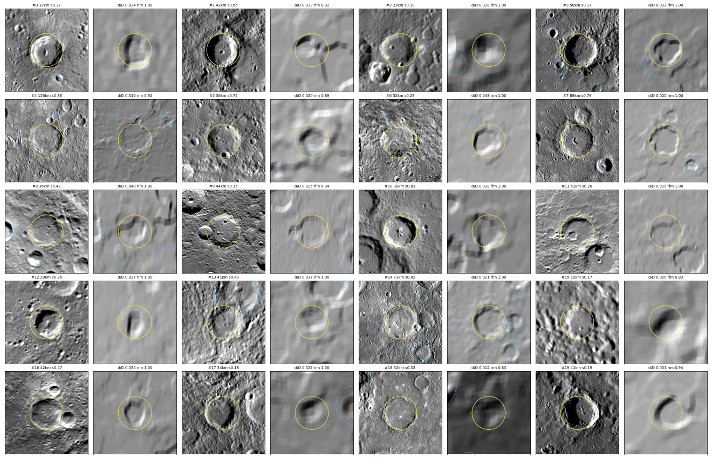
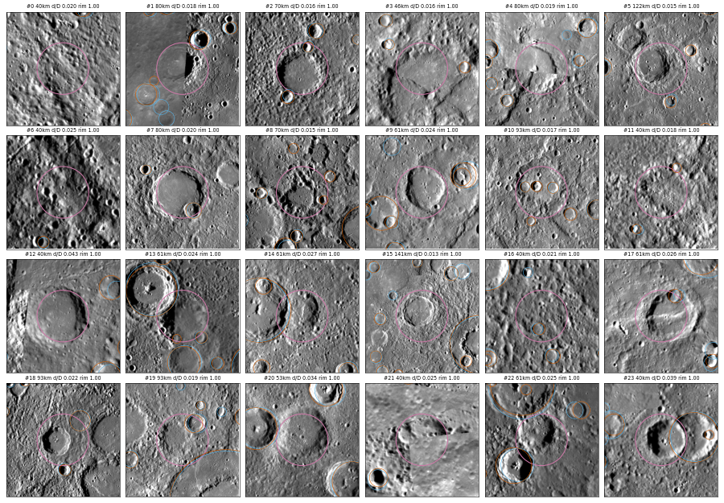
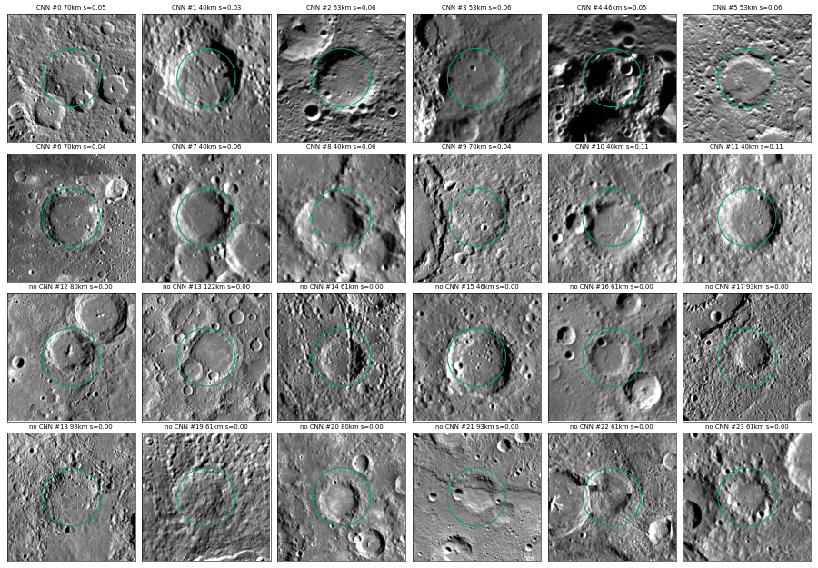

# Self-training with a DEM check

    python -m craters.demcheck      # fit the DEM bowl check
    python -m craters.selftrain     # rounds of pseudo-labelling + fine-tuning, gated on V1

The thesis catalog is the source of truth, but it was built from the image
mosaic alone and only counted clearly rimmed craters. Some real craters are
missing from it. Until now those taught the CNN "no crater here". This step
looks for them with evidence the catalog never used, the USGS 665 m DEM, and
feeds the confident ones back into training without anyone reviewing craters by eye.

## The DEM bowl check (`src/craters/demcheck.py`)

For a circle (lat, lon, D) the DEM is sampled on a polar grid: the floor (inside
0.4 radii), the highest point on each of 36 azimuths between 0.8 and 1.2 radii
(the rim), and the ground outside (1.6-2 radii). A circle passes when the rim
stands high enough above the floor on enough azimuths and the floor lies below
the surroundings.

The thresholds are fitted per diameter band on the train area. As many catalog
craters as possible should pass, while at most 1% of decoys may: decoys are
catalog circles moved 2-3 diameters onto ground the catalog says is empty.

| D (km) | catalog craters passing (train) | decoys passing (train) |
|---|---|---|
| 20-30 | 40% | 0.4% |
| 30-40 | 60% | 0.4% |
| 40-60 | 94% | 0.7% |
| 60-100 | 88% | 0.9% |
| 100-400 | 82% | 0% |

The check is strict by design. It misses many real craters, but when it says
yes it is almost never on empty ground. Below 20 km it can't separate catalog
craters from decoys at all (median depth/D of 10-20 km catalog craters is
0.001, the same as the decoys), so the DEM's effective resolution is far
coarser than its pixels, and no crater under 20 km is confirmed.

## DEM-confirmed craters missing from the catalog

A detection from the calibrated global run counts as a confirmed crater missing
from the catalog when it:

- matches no catalog crater;
- passes the bowl check;
- is not a copy, at a different size, of a catalog crater;
- is not centred inside a bigger catalog crater (a peak ring has a bowl too);
- is not drawn round a smaller catalog crater near its centre.

781 detections qualify (`outputs/selftrain/new_craters.csv`). 349 of them lie in
the areas excluded from training because the catalog looked incomplete there,
and 281 in the train area.

All 20 craters in a random sample look like real craters. Several are fresh,
with central peaks, and the nearest catalog crater is often 25-60 km away and
much smaller.

| D (km) | 20-30 | 30-40 | 40-60 | 60-100 | 100-400 |
|---|---|---|---|---|---|
| confirmed, not in the catalog | 156 | 271 | 238 | 96 | 20 |

## The loop (`src/craters/selftrain.py`)

Each round runs these steps, starting from the best model so far:

1. **Pseudo-labels, train area only.** Confirmed craters become positives.
   Other non-catalog detections with score >= 0.5 become "ignore".
2. **Fine-tune** that model on the catalog plus the pseudo-labels.
3. **Global run and calibration.**
4. **Gate.** The round is kept only if V1 F1 against the catalog doesn't drop.

The catalog is never edited, and V1, T1-T3 and their buffers never get
pseudo-labels. T1-T3 are reported, never used to decide.

## Results: both rounds rejected, fine-tuning is the problem

All F1 values are for the calibrated global run, scored against the catalog.

| run | recipe | new craters / ignored | V1 F1 | T1-T3 F1 | kept |
|---|---|---|---|---|---|
| cnn_reg_f2 (start) | - | - | 0.678 | 0.675 | - |
| round 1, first try | 16 epochs, lr 2e-4, V1 every 4 | 281 / 38 | 0.635 | 0.642 | no |
| control | 12 epochs, lr 5e-5, V1 every 2, no pseudo-labels | 0 / 0 | 0.587 | 0.583 | (reference) |
| round 1, retry | same as control | 281 / 38 | 0.595 | 0.589 | no |

The gate did its job, and `cnn_reg_f2` stays the published model.

The control fine-tune has no pseudo-labels, and it does worse than the start
model: V1 F2 falls from 0.735 to 0.64 at its very first check, after 2 epochs.
So fine-tuning from `cnn_reg_f2` loses accuracy whatever the labels.
With the same recipe, the pseudo-labels then do slightly better than the
control (V1 +0.009, T1-T3 +0.006), but that is within the noise.

Most likely, `cnn_reg_f2` is a lucky checkpoint of a noisy training run. Its V1
F-beta went 0.66, 0.53, **0.735**, 0.59 at epochs 8-20
(`data/models/cnn_reg_f2_history.csv`), and T1-T3 confirms it is genuinely good,
not just good on V1. Any further training moves away from that point.

To test the pseudo-labels properly, the training itself needs to be steadier:
average the weights over time (EMA/SWA), then compare full retrains with and
without pseudo-labels over several seeds. That costs hours of GPU time per
comparison, and is left for later.

The confirmed craters stand on their own: `outputs/selftrain/new_craters.csv`
is a supplement to the catalog, confirmed by evidence the thesis didn't use,
whether or not they ever help train the CNN. The rejected models and runs are
kept, outside git, in `data/models/selftrain_st1_rejected/` and
`data/models/selftrain_retry_rejected/`.

## DEM scan: big craters neither the catalog nor the CNN has

    python -m craters.demscan       # ~11 min on one CPU core; writes outputs/selftrain/demscan_new.csv

The CNN misses many big, degraded craters with soft rims and smooth floors.
The thesis didn't count them, so in training the CNN was taught they are "no
crater", and self-training can't help with craters the CNN never detects.
`src/craters/demscan.py` therefore uses the bowl check as a detector of its own.

The scan tests circles on a grid over the whole planet: 40 to 400 km in steps
of 1.15x, with centres 0.2 D apart, 4.8 million circles in all. The best bowl
among overlapping circles wins, and inner rings are dropped.

The rule is tuned on the train area:

- **Recall:** the share of catalog craters >= 40 km the scan finds.
- **Known:** the share of scan craters that match a catalog crater or a CNN
  detection, or are a mis-sized copy of one.

A 28 km crater shows up in the scan as a 40 km circle around it, so those
copies count as known.

| rim on every azimuth, depth/D >= | train recall | train known |
|---|---|---|
| 0.01 (chosen: best recall with known >= 0.8) | 0.76 | 0.81 |
| 0.02 | 0.68 | 0.82 |
| 0.03 | 0.42 | 0.86 |

With rims as loose as 75% of azimuths, the scan finds 92% of the catalog's
>= 40 km craters, so the DEM does see them. The trade-off is precision.

The chosen rule gives **827 scan craters >= 40 km in neither set**
(`demscan_new.csv`). They are **candidates, not confirmed**. In a random sample
of 24 from the train area, about half are real degraded craters. The rest are
shadowed scarps, mosaic seams, rough terrain, or circles drawn round a smaller
crater.

## Second opinion from the CNN

    python -m craters.demscan --cnn     # + ~10 min on the CPU: adds cnn_score and cnn_ok to demscan_new.csv

The 827 aren't in the calibrated CNN run, but the CNN may still see them faintly.
The coarse level of `cnn_reg_f2` is re-run over the planet at a score of 0.02
instead of 0.15, and each scan crater gets the best score of a detection
matching it.

Decoys measure how often that happens by chance. They are 370 train-area
catalog circles >= 40 km, moved onto ground the catalog says is empty. Precision is estimated
conservatively as 1 - (decoy rate x 827) / (number supported), as if all 827
were false. The cutoff kept is the one supporting the most scan craters with
that estimate >= 0.85.

| CNN score >= | catalog craters supported | decoys supported | new scan craters supported | precision, lower bound |
|---|---|---|---|---|
| **0.02 (chosen)** | 97% | 6.5% | **386** | 0.86 |
| 0.03 | 97% | 4.6% | 313 | 0.88 |
| 0.05 | 97% | 3.0% | 193 | 0.87 |
| 0.10 | 97% | 2.4% | 61 | 0.67 |

The decoy rate is itself an overestimate, since the catalog is missing big
craters, so some decoys land on real ones.

By eye, all 12 of a random 12 supported scan craters are clear craters, and
about 21 of 24 with scores of only 0.02-0.03. The CNN only adds evidence. Many
of the unsupported scan craters look real too, mostly the bigger ones
(60-120 km), where the coarse level is weakest.

The map viewer shows these as two layers. **"DEM scan + CNN"** (blue, 386
craters, on by default) is found by two independent methods, the elevation
model and the image CNN. It is the most reliable supplement to the catalog
here for big craters, after the 781 DEM-confirmed CNN craters. **"DEM scan
only"** (green, 441, off by default) is weaker. Neither has been used for
training.

## The supplemented catalog (`src/craters/supplement.py`)

    python -m craters.supplement            # build it
    python -m craters.supplement --score    # score the calibrated global run against both catalogs
    python -m craters.supplement --score NAME   # ... or any run: data/detections/NAME.parquet

The two sets of DEM-backed craters are folded into one catalog,
`data/processed/catalog_supplemented.parquet` (also
`outputs/selftrain/catalog_supplemented.csv`). The thesis files are only read.
A `source` column says where each crater comes from:

| source | craters | what |
|---|---|---|
| `thesis` | 20,662 | the registered thesis catalog, unchanged |
| `dem_confirmed` | 774 | CNN detections >= 20 km that pass the DEM bowl check |
| `dem_scan_cnn` | 386 | DEM-scan craters >= 40 km that the CNN supports |

A new crater is dropped when it is the same crater, by the matching rule, as
one already listed. None of the new craters repeats a thesis crater, and none of
the scan craters repeats a DEM-confirmed one. 7 of the 781 DEM-confirmed
detections were the same crater detected twice, which leaves 774. The thesis
sheet name, called `source` in the other catalog files, is `sheet` here.

491 of the 1,160 new craters lie in the train area, 471 in the areas excluded
from training, 103 on the polar caps, 67 in T1-T3 and 8 in V1.

### `cnn_reg_f2` against both catalogs

Calibrated global run, craters >= 5 km. P / R / F1; the number of catalog
craters is in brackets.

| D (km) | V1, thesis | V1, supplemented | T1-T3, thesis | T1-T3, supplemented |
|---|---|---|---|---|
| all | 0.61 / 0.76 / **0.678** (487) | 0.62 / 0.76 / **0.682** (495) | 0.68 / 0.68 / **0.675** (1,982) | 0.70 / 0.68 / **0.688** (2,049) |
| 5-10 | 0.57 / 0.70 / 0.628 (307) | same | 0.59 / 0.55 / 0.567 (1,091) | same |
| 10-20 | 0.73 / 0.88 / 0.797 (116) | same | 0.77 / 0.82 / 0.797 (564) | same |
| 20-50 | 0.64 / 0.82 / 0.719 (56) | 0.67 / 0.81 / 0.733 (59) | 0.75 / 0.86 / 0.801 (272) | 0.87 / 0.85 / 0.862 (319) |
| 50+ | 0.47 / 0.88 / 0.609 (8) | 0.67 / 0.77 / 0.714 (13) | 0.73 / 0.82 / 0.769 (55) | 0.90 / 0.75 / 0.818 (75) |

Per test region, F1 for all sizes goes from 0.615 to 0.626 (T1), 0.721 to
0.741 (T2) and 0.703 to 0.712 (T3); the full table is
`outputs/selftrain/scores_global_cnn_reg_f2_calibrated.csv`.

Nothing changes below 20 km, where there are no new craters. From 20 km up,
precision in T1-T3 rises from 0.75 to 0.87 (20-50 km) and from 0.73 to 0.90
(50+ km): about half of what counted as false detections there are craters the
DEM confirms. Recall falls at 50+ km (0.82 to 0.75), because the scan craters
are ones the CNN run missed.

Two cautions when reading the supplemented columns:

- The `dem_confirmed` craters are detections of `cnn_reg_f2` itself, so this
  model finds all of them by construction. The precision gain is real, but a
  different model would not get those matches for free. Comparisons between
  models are fair on the thesis catalog, and tilted towards `cnn_reg_f2` on the
  supplemented one.
- V1 has only 8 new craters, so its supplemented scores barely differ, and its
  50+ km bin (8 and 13 craters) is too small to read.
